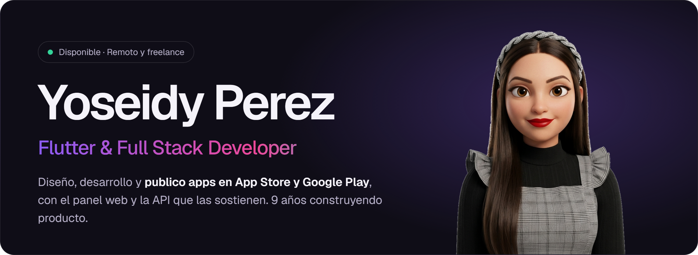
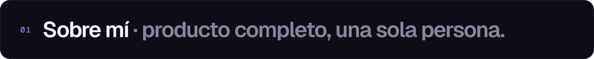
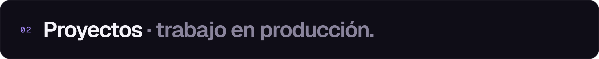
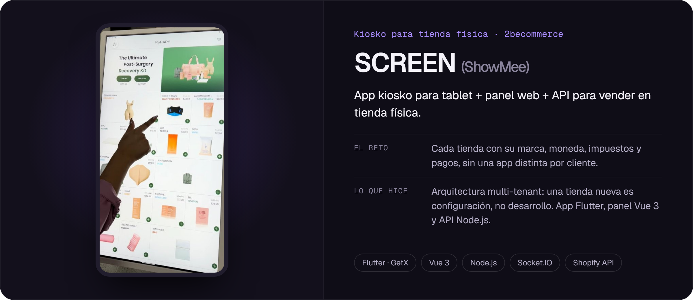
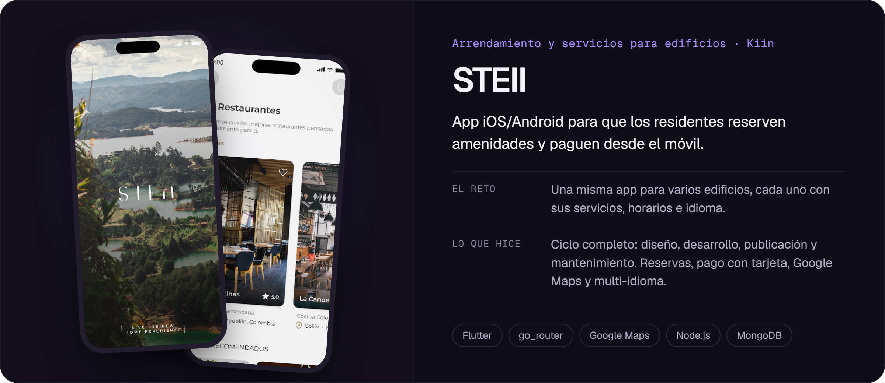
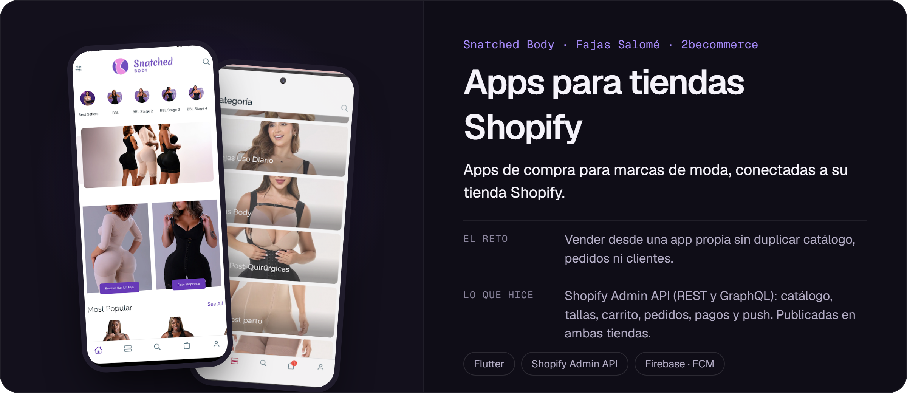
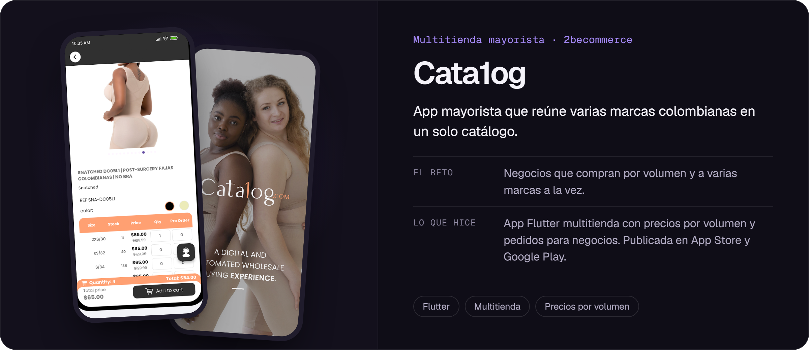
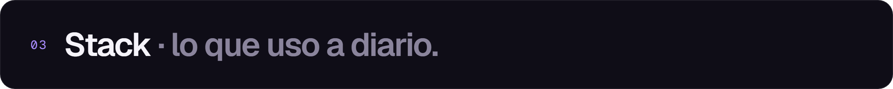
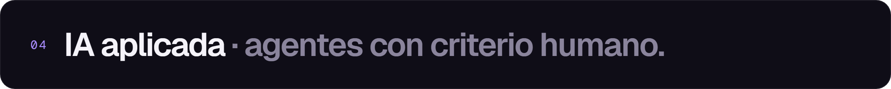
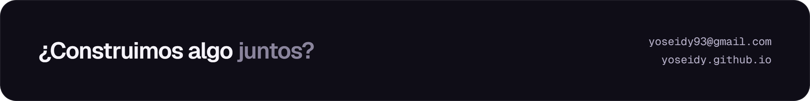

  
  
  
  

Soy **Ingeniera Informática** con 9 años de experiencia. Empecé en el frontend y fui creciendo hasta encargarme de productos completos: hoy diseño la **app Flutter**, el **panel en Vue 3** y la **API en Node.js**, y me ocupo de que lleguen a **App Store y Google Play** y se mantengan al día.

- 📱 Apps Flutter publicadas para retail, kioscos en tienda física y edificios residenciales
- 🧩 Arquitecturas multi-tenant: varios clientes con una sola base de código
- 💳 Pagos (MercadoPago, PayPal, Braintree, QR), Shopify Admin API y tiempo real con Socket.IO
- 🌎 He trabajado en Venezuela, Panamá y Colombia · hoy en Envigado, Colombia · remoto y freelance

Todas las pantallas son capturas reales de apps publicadas. El código de estos proyectos es privado (trabajo para empresa).

  

**Mobile** Flutter · Dart · GetX · Riverpod · Clean Architecture · Ionic &nbsp;·&nbsp; **Web** Vue 3 · Pinia · Vuetify · Angular · React (básico) &nbsp;·&nbsp; **Backend** Node.js · Express · MongoDB · PostgreSQL · Django · Laravel &nbsp;·&nbsp; **Integraciones** Shopify Admin API · REST · GraphQL · Socket.IO · FCM · Google Maps

Programo con **Claude Code** todos los días. La diferencia no está en usar agentes, sino en saber revisar lo que entregan:

| 01 · Entiendo y planifico | 02 · El agente propone | 03 · Yo reviso y corrijo | 04 · Entrego y publico |
|---|---|---|---|
| Defino qué se construye y cómo, antes de tocar código. | Claude Code acelera la implementación y la documentación. | Leo cada cambio y compruebo que funcione. Nada entra sin mi aprobación. | A tiempo en las tiendas y con el código ordenado. |

